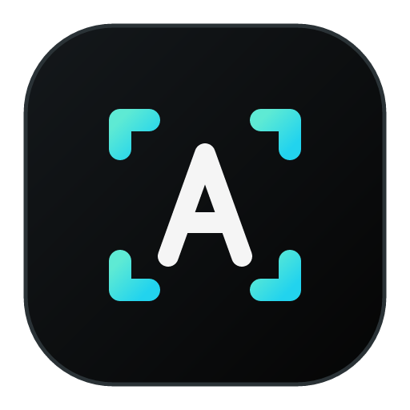
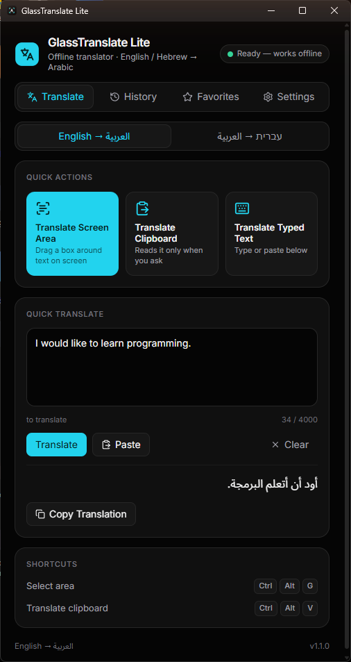
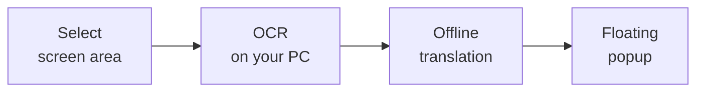
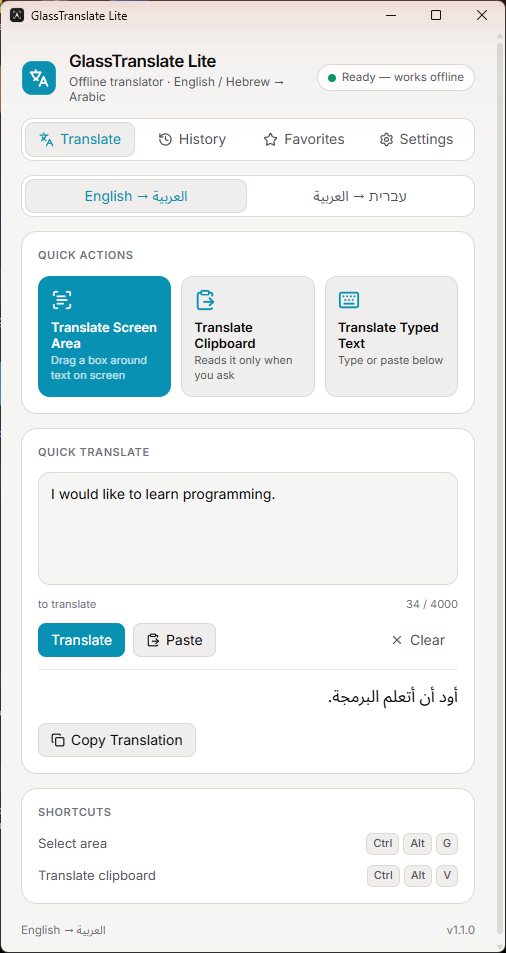
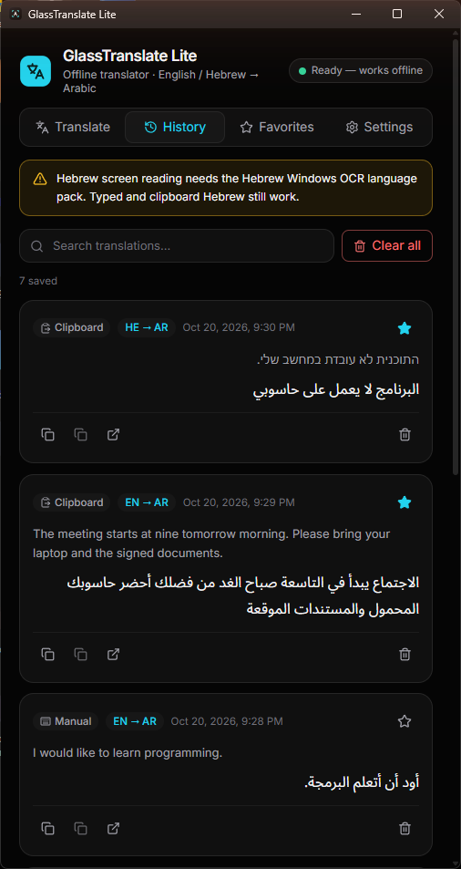
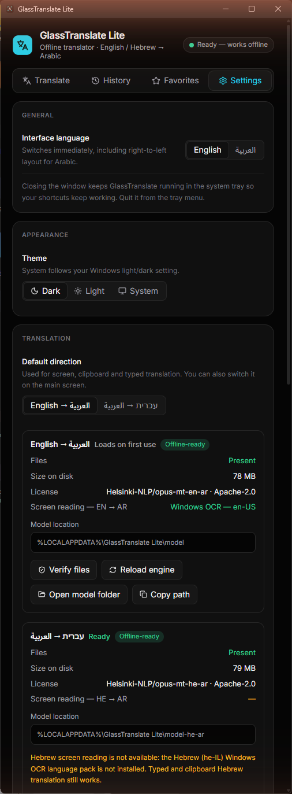
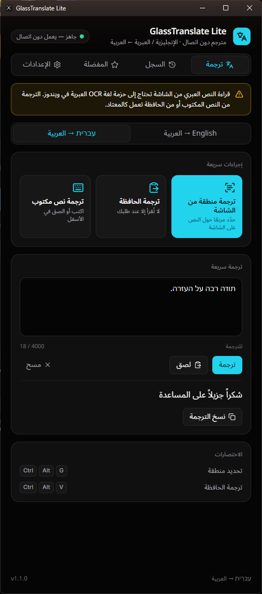
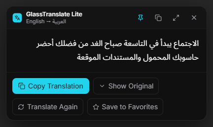
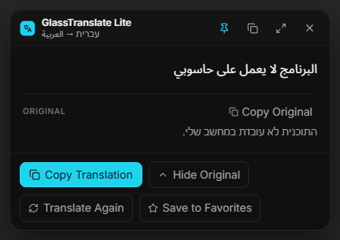

<p align="center">
  
</p>

<h1 align="center">GlassTranslate Lite</h1>

<p align="center">
  <b>Translate your screen. Understand everything.</b>
</p>

<p align="center">
  An offline, privacy-first Windows translator that turns English and Hebrew text on your screen,<br>
  clipboard or keyboard into Arabic, in a clean glass popup.
</p>

<p align="center">
  
  
  
  
  
  
  
  
  
</p>

<p align="center">
  <a href="#download--installation">Download</a> ·
  <a href="#features">Features</a> ·
  <a href="#screenshots">Screenshots</a> ·
  <a href="#download--installation">Installation</a> ·
  <a href="#build-from-source">Build</a>
</p>

<p align="center">
  
</p>

---

## Features

| | |
|---|---|
| 🖥️ **Instant screen translation** | Press `Ctrl+Alt+G`, drag a box around any text, and read the Arabic translation right there. |
| 📴 **Fully offline** | OCR and translation run on your PC. No cloud service, no paid API, no account. |
| 📋 **Clipboard translation** | Press `Ctrl+Alt+V` to translate what you copied. The clipboard is read only when you ask. |
| 🪟 **Floating glass popup** | Copy, favorite, drag, pin, *Translate again*. Arabic and Hebrew display right-to-left. |
| ⭐ **History & favorites** | Optional and off by default. Searchable, stored only on your PC. |
| 🎨 **Personalization** | English or Arabic interface, dark / light / system theme, popup opacity, rebindable shortcuts, system tray. |

## How it works



1. **Select**: press `Ctrl+Alt+G` and drag a box around the text (or copy text and press `Ctrl+Alt+V`, or type it in).
2. **OCR**: Windows OCR reads English; a bundled Tesseract reads Hebrew. The screenshot stays in memory.
3. **Offline translation**: a bundled CTranslate2 model translates to Arabic on your CPU.
4. **Floating popup**: the result appears next to your work without taking focus from the app you are typing in.

## Supported languages

| Translation | Screen OCR engine |
|---|---|
| English → Arabic | Windows OCR (`en-US`) |
| Hebrew → Arabic (direct, no pivot) | Bundled Tesseract 5.4.0 |

- **Interface:** English and Arabic (Arabic switches the whole layout to right-to-left).
- **Hebrew is a source language only.** There is no Arabic → English/Hebrew translation.
- Typed and clipboard text need no OCR, so they work in either direction as soon as the model is loaded.

## Shortcuts

| Action | Default |
|---|---|
| Select screen area and translate | `Ctrl+Alt+G` |
| Translate clipboard | `Ctrl+Alt+V` |

Both can be changed in **Settings**.

## Screenshots

Switch direction (`English → العربية` / `עברית → العربية`) at the top of the Translate tab.

<table>
  <tr>
    <td align="center" valign="top" width="50%">
      <br>
      <sub><b>Main window · light</b></sub>
    </td>
    <td align="center" valign="top" width="50%">
      <br>
      <sub><b>History &amp; favorites</b></sub>
    </td>
  </tr>
  <tr>
    <td align="center" valign="top" width="50%">
      <br>
      <sub><b>Settings</b></sub>
    </td>
    <td align="center" valign="top" width="50%">
      <br>
      <sub><b>Arabic interface (RTL)</b></sub>
    </td>
  </tr>
  <tr>
    <td align="center" valign="top" width="50%">
      <br>
      <sub><b>Popup · English → Arabic</b></sub>
    </td>
    <td align="center" valign="top" width="50%">
      <br>
      <sub><b>Popup · Hebrew → Arabic</b></sub>
    </td>
  </tr>
</table>

<sub>Screenshots were captured from the installed 1.1.0 build. 1.1.2 keeps the same layout. The one visible difference is that
1.1.0 showed a "Hebrew screen reading needs the Windows Hebrew OCR language pack" notice (in Settings, History and the
Arabic view); 1.1.1 and later bundle their own Hebrew OCR, so that notice no longer applies.</sub>

## Download & Installation

- **Requirements:** Windows 10 or 11, x64. No administrator rights, Python, Rust or Node.js needed to *run* the app.
- **Installer:** `GlassTranslate Lite_1.1.2_x64-setup.exe` (NSIS, per-user, about 168 MB). Both translation models and
  the Hebrew OCR engine are **bundled**, so there is no extra download after install.
- **No public release is published yet.** There is no download link here on purpose; build the installer yourself
  (see [Build from source](#build-from-source)) or get it from whoever shared it with you.
- Run the setup file. It installs to `%LOCALAPPDATA%\GlassTranslate Lite\` and can be installed over 1.1.0 or 1.1.1. Close the app (tray icon → *Quit*) before upgrading so the old executable is not locked.
- Settings and history live in `%APPDATA%\com.glasstranslate.lite\`. Uninstalling removes the program and leaves these files.

## Technology stack

| Layer | Technology |
|---|---|
| App shell | [Tauri 2](https://tauri.app) (Rust) |
| Interface | React 19, TypeScript, Tailwind CSS 4, Vite |
| Translation | [CTranslate2](https://github.com/OpenNMT/CTranslate2) (int8) with [Helsinki-NLP OPUS-MT](https://huggingface.co/Helsinki-NLP) models |
| English OCR | Windows OCR (`Windows.Media.Ocr`) |
| Hebrew OCR | [Tesseract](https://github.com/tesseract-ocr/tesseract) 5.4.0 + `heb` data (`tessdata_best`) |

## Privacy first

- OCR and translation run **locally**. No paid API, no account, no telemetry.
- The app's own code makes no network requests and has no HTTP client among its direct dependencies. A run with the
  network blocked has **not** been performed.
- The clipboard is read only when you press the clipboard shortcut or button.
- History is **off by default** and stored only on your PC.
- Screenshots for OCR are processed in memory and are not saved.

## Build from source

Requires Node.js, Rust (MSVC toolchain) and CMake. Building the translation models also needs Python 3.9+ on `PATH`
and about 3 GB of temporary disk space.

```bash
npm install
node scripts/prepare-model.mjs en-ar   # builds src-tauri/resources/model
node scripts/prepare-model.mjs he-ar   # builds src-tauri/resources/model-he-ar
npm run tauri build
```

The installer is written to `src-tauri/target/release/bundle/nsis/`. Model files are not committed (see `.gitignore`);
the Tesseract files are. To check your build, run `npx tsc --noEmit` in the repository root and
`cargo test --release` in `src-tauri`.

<details>
<summary><b>Translation models</b></summary>

<br>

| Direction | Model | Method | License |
|---|---|---|---|
| English → Arabic | [Helsinki-NLP/opus-mt-en-ar](https://huggingface.co/Helsinki-NLP/opus-mt-en-ar) | direct | Apache-2.0 |
| Hebrew → Arabic | [Helsinki-NLP/opus-mt-he-ar](https://huggingface.co/Helsinki-NLP/opus-mt-he-ar) | direct (no pivot through English) | Apache-2.0 |

Both are converted to CTranslate2 int8 by `scripts/prepare-model.mjs` and verified against SHA-256 lists
(`scripts/model.sha256`, `scripts/model-he-ar.sha256`). Models load lazily; only the default direction's model is loaded
at startup. These are small Marian models: short sentences translate well, long or technical text may be imperfect, so
check important translations.

</details>

<details>
<summary><b>OCR details</b></summary>

<br>

- **English → Arabic** uses the Windows built-in OCR engine (`en-US`, present on a standard Windows install).
- **Hebrew → Arabic** uses a **bundled, offline Tesseract 5.4.0** with the official `heb.traineddata` and `eng.traineddata`.
  It needs no Windows Hebrew language pack, no global Tesseract install and no PATH entry. Tesseract runs as a hidden
  child process and the screenshot is passed in memory. Dark UIs (for example Discord) are handled by automatic inversion
  and contrast stretching; mixed Hebrew/English text, numbers and punctuation are supported.
- If the bundled Hebrew OCR files are missing or damaged, the app says so. Manual and clipboard translation keep working.
- OCR accuracy on very small or low-contrast text is limited; select a tight region around the text.

</details>

<details>
<summary><b>Testing status (1.1.2)</b></summary>

<br>

**Automated and static checks**

- `cargo test --release --lib`: 24 passed, 0 failed. This includes the bundled-Tesseract integrity check, OCR
  post-processing tests and Hebrew OCR on rendered test images (not real screen captures): 13 of 18 lines exact, 96.0 %
  character accuracy. Typical errors are `ב`/`כ` confusions at small sizes; 12 px text is the weakest case.
- Hebrew → Arabic with the real bundled model, for example `התוכנית לא עובדת במחשב שלי.` → `البرنامج لا يعمل على حاسوبي`.
- TypeScript typecheck, frontend build, Rust build, Tauri production build and NSIS installer build.
- Uninstaller: the generated NSIS script was reviewed (per-user, opt-in "delete app data" checkbox). It was **not** run.

**Verified by hand on the installed 1.1.2 app** (installed over a half-upgraded 1.1.x)

- Settings shows the engine per direction: English → Arabic "Windows OCR — en-US", Hebrew → Arabic "Bundled Tesseract
  OCR — Hebrew (offline)"; both models present.
- Hebrew screen OCR with `Ctrl+Alt+G` on a Notepad window at 100 % zoom: the popup (titled עברית → العربية) showed the
  Arabic translation, no language-pack error. The text read back by Tesseract had minor bracket artifacts. This was a
  controlled Notepad window, **not** Discord. (Earlier 1.1.1 run: dark Notepad at 150 %, all five sentences.)
- English screen OCR with `Ctrl+Alt+G` after switching direction without a restart (Windows OCR →
  `أين يمكنني العثور على الملف؟ البرنامج لا يعمل على حاسوبي`), clipboard translation in both directions, and manual input in both directions.
- Direction switching without restart, *Translate again*, copy, dragging, pin, `Esc`, popup opacity and position,
  shortcut rebinding, history and favorites, Arabic RTL interface, light/dark theme.
- Tray icon, and left-click reopening the window after it was closed to the tray.
- Upgrade over the older install with settings and both models preserved.

</details>

## Known limitations

- **Not verified on the installed 1.1.2 app:** Hebrew capture inside Discord itself, the tray icon's right-click menu
  and *Quit*, restart persistence through the UI (checked on 1.1.0), the uninstaller, and any run with the network
  disconnected.
- Hebrew OCR depends on text size and contrast. Small text (about 12 px) can have letter confusions. Select a tight
  region, or copy the text and use `Ctrl+Alt+V`.
- The Hebrew → Arabic model often drops the full stop at the end of a sentence, so sentences can run together. A line
  Tesseract reports as a separate paragraph appears after a blank line, and in mixed Hebrew/English lines the Arabic word
  order can differ from the on-screen order.
- Windows x64 only.

## Credits & licensing

GlassTranslate Lite is released under the [MIT License](LICENSE). Third-party components keep their own licenses; see
[THIRD_PARTY_NOTICES.md](THIRD_PARTY_NOTICES.md) for the full list and attributions, and [CHANGELOG.md](CHANGELOG.md)
for release history.

- Translation models: [Helsinki-NLP OPUS-MT](https://github.com/Helsinki-NLP/Opus-MT) (Language Technology Research
  Group, University of Helsinki), Apache-2.0 on the Hugging Face model cards; the underlying OPUS / Tatoeba training
  data is CC-BY 4.0.
- Inference: [CTranslate2](https://github.com/OpenNMT/CTranslate2) (MIT) and [SentencePiece](https://github.com/google/sentencepiece) (Apache-2.0).
- OCR: [Tesseract](https://github.com/tesseract-ocr/tesseract) (Apache-2.0, UB Mannheim Windows build) with `tessdata_best` Hebrew data; Windows OCR for English.
- App: [Tauri](https://tauri.app), React, Vite, Tailwind CSS, Inter and Noto Sans Arabic fonts.

---

<p align="center">
  <sub>GlassTranslate Lite 1.1.2 · Offline · Private · Windows 10/11</sub>
</p>
